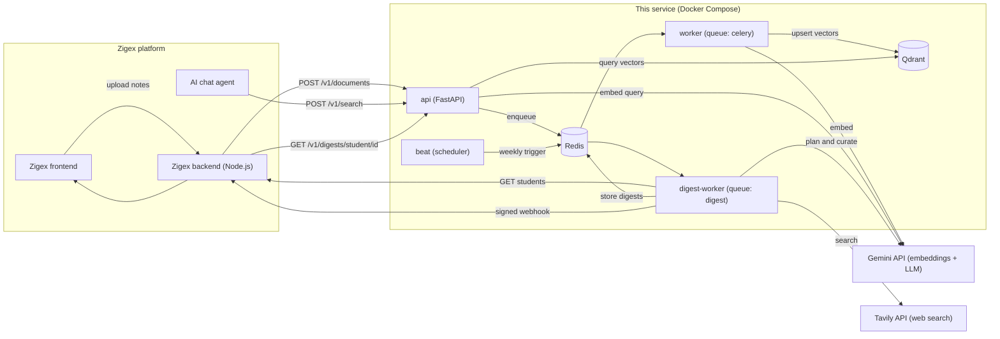

# Zigex AI Services: Documentation

# Part A: Overview

This is the first of seven parts. Parts B to G cover setup, the two subsystems, Zigex backend integration, operations and handoff.

---

## 1. Purpose and scope

### 1.1 Background

Zigex connects tech companies with students. Two needs led to this service:

1. **Internship support.** Supervisors (for example the ML or Web lead) upload course notes for a cohort. Interns then talk to an AI agent that must answer from *their own department's* material and nothing else.
2. **Opportunity discovery.** Companies publish events on Zigex, but students also need opportunities from the wider web (hackathons, internships, scholarships, conferences). Each student should receive a weekly, readable digest relevant to their profile.

### 1.2 What the service does

| Subsystem | Trigger | Output |
|---|---|---|
| **RAG ingestion and search** | A supervisor uploads a file | Searchable course content, isolated by department and cohort, which the AI agent queries for context |
| **Weekly opportunity digest** | A weekly cron job (or a manual run) | A blog-style Markdown post per student segment, with images, captions and links, delivered to Zigex |

### 1.3 Who uses it

| Actor | Interaction |
|---|---|
| **Supervisor** | Uploads course notes through the Zigex UI, which calls `POST /v1/documents` |
| **Intern** | Chats with the AI agent. The agent backend calls `POST /v1/search` on the intern's behalf |
| **Student (700+)** | Reads the weekly digest inside Zigex |
| **Zigex backend** | Calls this service's API, supplies student profiles, and receives digests by webhook |
| **Zigex staff** (optional) | Approves digests before they are delivered, when review mode is on |

### 1.4 In scope

- Parsing, chunking, embedding and storing course documents (PDF, DOCX, PPTX, Markdown, TXT)
- Department- and cohort-filtered semantic search
- Weekly web search for opportunities, curation, blog generation and delivery
- A REST API, a task queue, a scheduler and Docker packaging

### 1.5 Out of scope

- The AI chat agent itself (it only *consumes* `/v1/search`)
- The Zigex frontend, user accounts and authentication
- Email, push or SMS delivery of digests (Zigex does this after receiving the webhook)
- Long-term analytics

### 1.6 Assumptions

- The Zigex backend is a **Node.js** service. Integration examples in Part E use Express. The contracts themselves are language-neutral.
- Zigex can expose an endpoint that lists student profiles, and can receive a signed webhook.
- Department and cohort for each intern are known to the Zigex backend and are **never** taken from chat text.

---

## 2. Architecture

### 2.1 System diagram

### 2.2 Services

| Service | Image / process | Responsibility |
|---|---|---|
| `api` | FastAPI on port 8000 | Receives uploads, serves search and digest endpoints, validates API keys |
| `worker` | Celery, queue `celery` | Document ingestion: parse, chunk, embed, index |
| `digest-worker` | Celery, queue `digest` | Weekly digest jobs, one task per student segment |
| `beat` | Celery Beat | Fires the weekly digest job on schedule. **Run exactly one instance** |
| `redis` | `redis:7-alpine` | Task broker, ingestion status, digest storage, de-duplication sets |
| `qdrant` | `qdrant/qdrant` | Vector database for course content |

`api`, `worker`, `digest-worker` and `beat` all run the **same Docker image** (`rag-ingest:latest`) with different commands.

### 2.3 Flow 1: course content (RAG)

1. A supervisor uploads a file with `department` and `cohort_id`.
2. The API saves the file, records status `queued` in Redis, and enqueues a job. It returns `202` immediately.
3. The worker parses the file, splits it into chunks, and embeds each chunk with Gemini.
4. Vectors and metadata go into one Qdrant collection, tagged with `department` and `cohort_id`.
5. When an intern asks a question, the agent backend sends the question together with the intern's department and cohort. The service embeds the question and returns the closest chunks **filtered to that department and cohort**.

### 2.4 Flow 2: weekly digest

1. Celery Beat fires `digest.run_weekly` every Monday at 06:00 (Africa/Douala, configurable).
2. The job fetches student profiles from Zigex and groups them into **segments** (department plus location).
3. One task per segment runs the agent: plan search queries, search the web with Tavily, curate results with Gemini, validate, and render Markdown.
4. The digest is stored in Redis and pushed to Zigex by signed webhook.
5. Zigex shows it to every student in that segment.

### 2.5 Why the two flows share a service

Both need the same infrastructure (FastAPI, Celery, Redis, Gemini keys) and the same security model. They are logically independent: they use different queues, different data and different endpoints, so either can be split into its own service later without changing the other.

---

## 3. Technology stack and design decisions

| Component | Choice | Why |
|---|---|---|
| API framework | **FastAPI** | Async-capable, automatic Swagger docs for testing, strong request validation |
| Task queue | **Celery + Redis** | Embedding and web research are slow. Uploads and cron runs must not block requests. Built-in retry and scheduling (Beat) |
| Vector database | **Qdrant** | Payload filtering and indexing for `department` and `cohort_id`, simple to run in Docker, scales to a cluster |
| Embeddings | **Gemini `gemini-embedding-001`, 768 dimensions** | Removes the local model download and the heavy `torch` dependency. Free tier available |
| LLM (digest) | **Gemini text model** (default `gemini-2.5-flash`, set with `LLM_MODEL`) | Plans queries and curates results. Returns JSON |
| Web search | **Tavily** | Search API built for AI agents. Returns results with images and descriptions |
| Chunking | **LangChain text splitters + tiktoken** | Token-based sizing and Markdown-header awareness |
| Packaging | **Docker Compose** | One command reproduces the whole stack |
| Language | **Python 3.10** | Matches the developer environment |

### 3.1 Key design decisions

| # | Decision | Reason |
|---|---|---|
| D1 | **Asynchronous ingestion** (`202` plus a status endpoint) | Embedding a large deck takes minutes. HTTP requests must stay short |
| D2 | **One Qdrant collection with payload filters**, not one collection per department | Simpler operations. Filters on indexed fields scale well |
| D3 | **Department and cohort come from the server, never from chat text** | Prevents an intern from reading another department's content by prompting |
| D4 | **Deterministic point IDs** (`document_id` plus chunk index) | Re-uploading a document replaces it instead of duplicating it |
| D5 | **Embedding model fixed per collection** | Vectors from different models are not comparable. Changing the model means re-indexing everything |
| D6 | **Search per segment, not per student** | 700+ students become roughly 10 to 25 agent runs a week, which keeps cost and rate limits manageable |
| D7 | **The LLM never writes URLs** | It selects sources and images by numeric ID. Code maps IDs to real links, so links cannot be invented |
| D8 | **Validation in code, not in the prompt** | Expired items, duplicates and already-sent links are removed deterministically |
| D9 | **Separate Celery queues** | A large weekly run can never block document uploads |
| D10 | **Only aggregate attributes go to third parties** | No names, emails or student IDs are sent to Tavily or Gemini |
| D11 | **Signed webhook delivery** | Zigex can verify that a digest really came from this service |

---

## 4. Glossary

| Term | Meaning |
|---|---|
| **RAG** | Retrieval-Augmented Generation. The agent retrieves relevant text first, then answers from it |
| **Chunk** | A small piece of a document (a few hundred tokens) that is embedded and searched individually |
| **Embedding** | A list of numbers (here 768) representing the meaning of a text. Similar texts have similar vectors |
| **Vector database** | A database that finds the stored vectors closest to a query vector |
| **Payload** | Metadata stored with each vector (department, cohort, title, page, text) |
| **Payload filter** | A condition applied during search, for example `department = ml` and `cohort_id = 3` |
| **Cosine similarity / score** | How close two vectors are, from -1 to 1. Higher means more relevant |
| **Cohort** | A group of interns who start together and share course content |
| **Department** | The track a student or supervisor belongs to (ml, web, mobile, devops, data) |
| **Segment** | A group of students with the same department and location. One digest is written per segment |
| **Digest** | The weekly blog post of opportunities for a segment |
| **Source ID / Image ID** | Numbers the LLM uses to point at search results and images, so it never writes URLs itself |
| **Celery** | A Python task queue that runs jobs in separate worker processes |
| **Queue** | A named line of jobs. This service uses `celery` for ingestion and `digest` for digests |
| **Beat** | Celery's scheduler. It enqueues the weekly digest job at the configured time |
| **Webhook** | An HTTP call this service makes to Zigex when a digest is ready |
| **HMAC signature** | A hash of the webhook body, created with a shared secret, that lets the receiver verify the sender |
| **Mock mode** | A setting (`MOCK_MODE=true`) that returns fake search and LLM responses so the pipeline can be tested without external keys |
| **Backoff** | Waiting progressively longer between retries after an error such as a rate limit (HTTP 429) |

---

**Next: Part B, Setup and reproduction** (sections 5 to 10).
