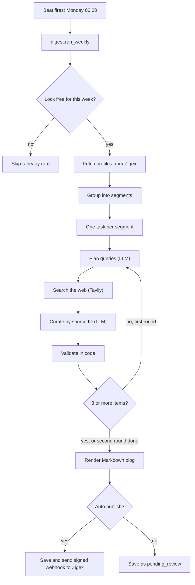

# Zigex AI Services: Documentation

# Part D: Subsystem 2, the weekly opportunity digest

This part explains how the service finds opportunities on the web for Zigex students once a week, turns them into a blog post, and hands the result to Zigex. It builds on the stack from Part B. Zigex-side integration is covered in Part E.



---

## 16. Segmentation

### 16.1 Why segments

Searching the web and calling an LLM once per student would mean 700+ runs a week, which is slow, costly and rate-limited. Students in the same department and city need nearly the same opportunities, so the system groups them and writes **one digest per segment**. With 700 students this is typically 10 to 25 runs.

### 16.2 Profile fields used

| Field | Used for |
|---|---|
| `id` | Delivering the digest to the right students (never sent to Tavily or Gemini) |
| `department` | Main grouping key. Lowercased. Profiles without one are skipped |
| `location` | Second grouping key (city or country). Lowercased and trimmed |
| `skills` | The most common ones guide the search and the "why it fits you" text |
| `interests` | Same, as a second signal |
| `level` | For example `beginner` or `final-year`. Guides how junior or senior the opportunities should be |

The profile reader accepts several key names so it tolerates different Zigex payloads: `id` or `student_id`; `department`, `track` or `field`; `location`, `city` or `country`. `skills` and `interests` can be a list or a comma-separated string. Section 24 shows how to adapt this to the real Zigex payload.

### 16.3 How segments are formed

1. Group profiles by `(department, location)`.
2. Any group with **fewer than 5 students** is merged into a department-wide group (`location` becomes "any"). This avoids running the whole pipeline for two or three students and keeps segments from describing an individual.
3. For each segment, compute:

| Field | Meaning |
|---|---|
| `segment_id` | `<department>__<location>`, for example `ml__bamenda`, or `ml__any` |
| `size` | Number of students |
| `top_skills` | The 8 most common skills |
| `top_interests` | The 6 most common interests |
| `levels` | The 3 most common levels |
| `student_ids` | Members (kept internally, used for delivery) |

### 16.4 Worked example

| Student profiles | Segments created |
|---|---|
| 6 ML students in Bamenda | `ml__bamenda` (size 6) |
| 1 ML student in Douala, 2 ML students in Yaounde | `ml__any` (size 3, merged because each city has fewer than 5) |
| 9 Web students in Douala | `web__douala` (size 9) |

### 16.5 What leaves your system

| Destination | What it receives |
|---|---|
| **Tavily** | Search query text built from department, location and month, for example `ml internships for students bamenda October 2026` |
| **Gemini** | Aggregate segment attributes (department, location, levels, top skills, top interests), plus public web search results |
| **Nobody outside your system** | Student IDs, names, emails and any individual profile |

Keep skills and interests as **controlled vocabulary** (tags) where possible. If students can type free text there, a very distinctive entry could identify someone in a small segment.

### 16.6 Data quality tips

- Use normalized location values from Zigex (`Bamenda`, not `Bamenda, North West, Cameroon` for some students and `bamenda` for others). The service lowercases and trims, but it does not merge different spellings.
- Use the same department codes you use for RAG (`ml`, `web`, and so on).

---

## 17. The agent pipeline

The "agent" is a bounded loop, not an open-ended one. It has at most **two rounds**, and each round has fixed steps. This keeps cost and runtime predictable.

### 17.1 Overview of one segment's run

| Step | What happens | Tool |
|---|---|---|
| 1. Plan | An LLM writes search queries for the segment | Gemini |
| 2. Search | Each query is run on the web, collecting results and images | Tavily |
| 3. Curate | An LLM picks the best opportunities **by ID** and writes short summaries | Gemini |
| 4. Validate | Code removes anything invalid, expired or repeated | Python |
| 5. Render | Code builds the Markdown blog post | Python |

If fewer than 3 valid items remain after step 4 in the first round, a second round runs with new queries. The run then ends either way.

### 17.2 Step 1: plan queries

The LLM receives the segment attributes and is asked for 4 queries (`DIGEST_QUERIES_PER_SEGMENT`) that:

- are 3 to 9 words each and target **different opportunity types** (internships, jobs, hackathons, scholarships, fellowships, bootcamps, conferences, workshops, competitions);
- include the location where sensible, and also cover remote or global options open to students there;
- contain no dates or years (the code adds the month and year itself);
- do not repeat queries from an earlier round.

**Fallback:** if the LLM fails or returns nothing, four template queries are used (internships, hackathon, scholarships and fellowships, conferences and workshops, each for the department and location).

### 17.3 Step 2: search the web

For each query the code appends the current month and year (for example `October 2026`) and calls Tavily with:

| Parameter | Value | Reason |
|---|---|---|
| `topic` | `general` | Opportunities are listings, not news |
| `search_depth` | `basic` | Cheapest. `advanced` costs more credits per search |
| `max_results` | 6 | Enough variety per query |
| `time_range` | `month` | Keeps results fresh |
| `include_images` and `include_image_descriptions` | `true` | Provides pictures and a description of each |

Details:

- Results are pooled by URL. A URL is skipped if it is already in the pool or was **sent to this segment in a previous week**.
- Images are pooled by URL.
- A failed search is logged and skipped. A transient Tavily error is retried up to 3 times (waiting 2, 4 and 6 seconds). If **every** search fails, the segment's task raises an error.

### 17.4 Step 3: curate

The LLM is shown up to **24 sources** (highest Tavily score first) and up to **15 images**. Each source is shown as an object with a numeric `id`, a short title, the site name, the published date if known, and the first 600 characters of text. Each image has an `id`, a description and a site name. The prompt also contains today's date.

It must return JSON with `headline`, `intro` and up to `DIGEST_MAX_ITEMS` (6) `items`. Each item has:

| Field | Meaning |
|---|---|
| `source_id` | Number of the source it chose. **The LLM never writes URLs** |
| `title`, `summary`, `why_relevant` | Short text for students. Summary is 1 to 2 sentences, "why relevant" is one sentence tied to the group's skills |
| `category` | One of: internship, job, hackathon, scholarship, conference, workshop, fellowship, competition, other |
| `event_date`, `deadline` | ISO dates (`YYYY-MM-DD`), only if stated in the source text, otherwise `null` |
| `location` | Where it happens, if known |
| `image_id`, `image_caption` | An image only if its description clearly matches that specific opportunity. Caption of at most 20 words |

Tavily returns images for the query as a whole, not attached to individual results. The LLM therefore matches an image to an opportunity using the image's description, and leaves it `null` when there is no clear match.

### 17.5 Step 4: validate

Described fully in section 18. In short, the code rejects unknown source IDs, expired items, repeated URLs and malformed items, and converts IDs to real URLs.

### 17.6 Step 5: render

Each digest is built as Markdown:

```markdown
# <headline>

*Week 2026-W42*

<intro>

## 1. <title>


*<caption> (Image via <image site>)*

<summary>

**Why it fits you:** <why_relevant>

**Date:** 2026-11-02 · **Deadline:** 2026-10-28 · **Where:** Remote · **Type:** hackathon

[Learn more / apply on <site>](<url>)

---

*Always verify an opportunity on the organiser's official site before applying.
Legitimate programmes never ask you to pay to apply.*
```

Date, deadline and location lines appear only when known. The image block appears only when an image was matched.

### 17.7 The digest object

```json
{
  "segment_id": "ml__bamenda",
  "week": "2026-W42",
  "department": "ml",
  "location": "bamenda",
  "headline": "Your week in ML",
  "intro": "Two sentences ...",
  "items": [
    {
      "title": "...", "summary": "...", "why_relevant": "...",
      "category": "hackathon",
      "event_date": null, "deadline": "2026-11-15", "location": "Remote",
      "url": "https://example.org/hackathon", "domain": "example.org",
      "image_url": "https://.../a.jpg",
      "image_caption": "Students at a hackathon",
      "image_credit": "example.org"
    }
  ],
  "markdown": "# Your week in ML\n\n...",
  "queries": ["ml internships bamenda", "..."],
  "status": "published",
  "delivered": true,
  "generated_at": "2026-10-12T06:03:41+01:00"
}
```

### 17.8 Volume per segment

| Resource | Typical use per segment |
|---|---|
| Gemini LLM calls | 2 to 4 (one plan and one curate per round) |
| Tavily searches | 4 to 8 (4 queries per round, up to 2 rounds) |
| Runtime | 1 to 3 minutes, including rate-limit waits |

### 17.9 When a digest is empty

If no valid items remain after both rounds, the digest is stored with `status: "empty"`, nothing is delivered, and the run counter `empty` goes up. This is normal for niche segments and is not an error.

A digest with **at least one** valid item is published. If you want a higher minimum, change `MIN_ITEMS` and add a check before publishing.

---

## 18. Safety design

Students may act on what they read, so the pipeline treats the LLM and the web as untrusted. Controls are placed in code, not only in the prompt.

| Risk | Control | Where |
|---|---|---|
| **Invented links** | The LLM outputs only a numeric `source_id`. The code maps it to a URL from Tavily's results. An ID that does not exist is dropped | `digest_agent._curate` |
| **Invented images** | Same approach with `image_id`. Invalid IDs give no image. Non-`http(s)` URLs are rejected | `digest_agent._curate` |
| **Expired opportunities** | If a deadline is in the past, the item is dropped. If there is no deadline but the event date is past, it is dropped. "Today" is computed in `DIGEST_TIMEZONE` | `digest_agent._curate` |
| **Guessed dates** | The prompt allows dates only when stated in the source. The code parses them as ISO dates. Unparseable values become `null` | prompt and `_parse_date` |
| **Duplicates in one digest** | Each URL can appear only once | `digest_agent._curate` |
| **Repeats across weeks** | URLs already sent to a segment (kept 60 days) are removed before the LLM sees them | `digest_store.get_seen` |
| **Malformed LLM output** | JSON is requested explicitly and parsed. Invalid JSON is retried up to 3 times. Each item is validated separately, and a bad item is skipped without failing the digest | `llm.generate_json`, `CuratedItem` |
| **Prompt injection from web pages** | Sources are labelled as untrusted data and the model is told to ignore any instructions inside them. Because the model can only pick IDs, injected text cannot add new links | prompt and ID mapping |
| **Scams and paid applications** | The prompt tells the model to skip anything that asks students to pay, looks like a scam or MLM, or is too vague. Every digest ends with a verify-before-applying notice | prompt and renderer |
| **Student privacy** | Only aggregate segment attributes leave the system | `Segment.public()` |
| **Overloading providers** | Segment tasks are limited to 6 per minute per worker, with retries and backoff | `digest_tasks` |

### 18.1 Residual risks to be aware of

1. **Items with no dates are kept.** The code cannot prove they are current. Tavily's one-month window and the prompt reduce the chance, but a stale listing can slip through.
2. **The LLM may still misjudge a scam.** The prompt is a guard, not a guarantee. This is the main reason to start in **review mode** (`DIGEST_AUTO_PUBLISH=false`) and have Zigex staff approve digests for the first several weeks.
3. **Injected text can still shape wording.** The model could repeat misleading text in a summary even though it cannot add links. Review mode covers this too.
4. **Render safely on the Zigex side.** The `markdown` field contains text derived from third-party pages. The Zigex frontend must sanitize it (no raw HTML, no scripts), and should open links with `rel="noopener noreferrer"`.
5. **Image rights and hotlinking.** Images belong to third parties. The digest credits the image's site, but credit is not permission. Hotlinked images can also break or be blocked. If this matters legally for Zigex, show link cards without images, or fetch and host images only from sources whose licence allows it.

---

## 19. Scheduling

### 19.1 The schedule

Celery Beat is the scheduler. The schedule is defined in `app/worker/celery_app.py`:

```python
beat_schedule = {
    "weekly-opportunity-digest": {
        "task": "digest.run_weekly",
        "schedule": crontab(day_of_week=settings.digest_cron_day,
                            hour=settings.digest_cron_hour, minute=0),
    },
}
```

Default: **every Monday at 06:00, Africa/Douala** (UTC+1, no daylight saving). It is controlled by three variables:

| Variable | Example | Result |
|---|---|---|
| `DIGEST_TIMEZONE` | `Africa/Douala` | Time zone the cron expression is read in |
| `DIGEST_CRON_DAY` | `fri` | Day of the week |
| `DIGEST_CRON_HOUR` | `8` | Hour of the day |

Example: `DIGEST_CRON_DAY=fri` and `DIGEST_CRON_HOUR=8` gives Fridays at 08:00. After changing them, run `docker compose up -d` so `beat` restarts. The environment variables support one weekday and a fixed minute of 0. For anything more complex, edit the `crontab(...)` expression directly.

### 19.2 What `digest.run_weekly` does

1. Computes the ISO week ID (for example `2026-W42`).
2. Takes a **run lock** in Redis (`digest_run_lock:<week>`, kept 6 days). If the lock exists, the job returns `skipped`. This stops a duplicate trigger in the same week. `force=true` bypasses it.
3. Gets profiles from the request body (if provided) or from the Zigex API.
4. Groups them into segments and stores the segment-to-student mapping.
5. Initializes run counters (`total`, `done`, `empty`, `failed`).
6. Enqueues one `digest.build_segment` task per segment, then finishes quickly.

### 19.3 What `digest.build_segment` does

1. Loads the URLs already sent to that segment.
2. Runs the agent (section 17).
3. Sets the digest status (section 20), saves it, and, if published, marks its URLs as seen and sends the webhook.
4. Updates the run counters.

**Retries:** automatic for connection errors, Gemini API errors and HTTP errors, up to 2 times, waiting 60 seconds growing to a 10-minute cap. Other errors (for example every Tavily search failing) mark the segment `failed` straight away.

### 19.4 Queues and workers

| Queue | Consumed by | Contains |
|---|---|---|
| `celery` | `worker` | Document ingestion |
| `digest` | `digest-worker` | `digest.run_weekly` and `digest.build_segment` |

`task_routes` sends every task whose name starts with `digest.` to the `digest` queue. A large weekly run therefore cannot delay a supervisor's upload.

**Pace:** segment tasks are limited to 6 per minute per `digest-worker`. Twenty-five segments therefore start over about four to five minutes and finish a few minutes after that.

### 19.5 Rules for operating the scheduler

- **Run exactly one `beat` instance.** Never scale it. Two schedulers would trigger every job twice (the run lock would catch most duplicates, but do not rely on it).
- **Scale `digest-worker` freely** if runs take too long: `docker compose up -d --scale digest-worker=2`.
- **A missed run is not replayed.** If `beat` is down at Monday 06:00, nothing runs that week. Check `docker compose ps` on Monday morning, or trigger a run manually (21.2).
- The schedule file lives in the container (`/tmp/celerybeat-schedule`). Losing it is harmless for this kind of schedule.

### 19.6 Verifying the schedule

- At startup, `docker compose logs beat` shows `beat: Starting...`.
- When the job fires, it logs `Scheduler: Sending due task weekly-opportunity-digest (digest.run_weekly)`.
- To test without waiting a week, set `DIGEST_CRON_DAY` to today and `DIGEST_CRON_HOUR` to the next hour, run `docker compose up -d`, and watch `docker compose logs -f beat digest-worker` (use mock mode and a profile source that works, see section 21.2). Restore the real values afterwards.

### 19.7 Re-running

`POST /v1/digests/run` with `force=true` runs **all** segments again. For segments already published this week, the new digest **replaces** the stored one (same week and segment key) and is delivered again. To redo only failed segments, send `force=true` with `profiles` containing just those students. A per-segment re-run endpoint is on the roadmap (Part G).

---

## 20. Storage and delivery

### 20.1 Where digests are stored

Digests are stored in Redis (which has append-only persistence on, backed by the `redisdata` volume):

| Key | Type | Content | Kept |
|---|---|---|---|
| `digest:<week>:<segment_id>` | string (JSON) | The full digest | 120 days |
| `digests:<week>` | set | Segment IDs that have a digest that week | 120 days |
| `digest_latest:<segment_id>` | string | The most recent week for that segment | 120 days |
| `digest_run:<week>` | hash | Counters: `total`, `done`, `empty`, `failed` | 120 days |
| `digest_run_lock:<week>` | string | Prevents duplicate weekly runs | 6 days |
| `seen:<segment_id>` | set | URLs already sent, used to avoid repeats | 60 days |
| `segment_students:<segment_id>` | set | Student IDs in the segment | 30 days |
| `student_segment:<student_id>` | string | Which segment a student belongs to | 30 days |

Appendix B repeats this as a reference. For a long-lived production system, move digests to Postgres (Part F).

### 20.2 Digest statuses

| `status` | Meaning | Delivered? | URLs marked as seen? |
|---|---|---|---|
| `published` | Ready and visible to students | Yes, by webhook if configured | Yes |
| `pending_review` | Waiting for staff approval (`DIGEST_AUTO_PUBLISH=false`) | No | No |
| `dry_run` | Created by a run with `dry_run=true` | No | No |
| `empty` | No valid items found | No | No |

### 20.3 Delivery by webhook

For a published digest, the service sends `POST <ZIGEX_WEBHOOK_URL>` with a JSON body:

```json
{
  "event": "weekly_digest",
  "digest": { "...": "the digest object from 17.7" },
  "student_ids": ["s_101", "s_102", "s_103"]
}
```

Headers:

| Header | Value |
|---|---|
| `Content-Type` | `application/json` |
| `X-Zigex-Signature` | `sha256=<hex>`, an HMAC-SHA256 of the **raw request body** using `ZIGEX_WEBHOOK_SECRET`. Sent only when the secret is set |

Behaviour:

- A `2xx` response counts as success. Anything else is retried, up to 3 attempts in total, waiting 2, 4 and 8 seconds.
- The result is stored in the digest's `delivered` field (`true` or `false`).
- If delivery fails, the agent is **not** re-run. The digest stays stored with `delivered: false` and can be re-sent with the publish endpoint (21.7), or fetched by Zigex through the pull API (21.6).
- If `ZIGEX_WEBHOOK_URL` is empty, nothing is sent and `delivered` stays `false`. Zigex can still pull digests.

Section 25 specifies how the Zigex backend should verify the signature and handle retries.

### 20.4 Review mode

Set `DIGEST_AUTO_PUBLISH=false` to put a person in the loop:

1. Each digest is saved as `pending_review`. Nothing is sent and URLs are not marked as seen.
2. Staff call `GET /v1/digests?week=...` to see which segments are waiting and `GET /v1/digests/{week}/{segment_id}` to read each one.
3. Staff approve with `POST /v1/digests/{week}/{segment_id}/publish`. The digest becomes `published`, its URLs are marked as seen, and it is delivered.

Recommended rollout: run in review mode for the first 4 weeks, then switch to automatic once the quality is trusted.

### 20.5 Known behaviours to be aware of

1. **A `dry_run` or `pending_review` digest becomes the "latest" for its segment.** The student endpoint (21.6) returns only `published` digests, so until a new digest is approved, students of that segment get a `404`, even if an earlier week was published.
2. **A `dry_run` stores under the same key as a real run.** Running a dry run in a week that already has a real run replaces the stored published digest with the dry-run copy. For testing during a live week, use `/v1/digests/preview`, which saves nothing.
3. **Re-running a week replaces that week's digest** (19.7).

These are listed in the roadmap (Part G) as items to harden.

---

## 21. Digest endpoints

All endpoints need the header `x-api-key`. Base path: `/v1/digests`.

| Method | Path | Purpose |
|---|---|---|
| `POST` | `/preview` | Build one digest now and return it. Saves and sends nothing |
| `POST` | `/run` | Queue a full weekly run |
| `GET` | `/run-status` | Progress counters for a week |
| `GET` | `` (empty path) | List a week's digests |
| `GET` | `/student/{student_id}` | Latest published digest for a student |
| `GET` | `/{week}/{segment_id}` | One full digest |
| `POST` | `/{week}/{segment_id}/publish` | Approve and deliver (or re-deliver) |

> **For maintainers:** `/student/{student_id}` and `/{week}/{segment_id}` have the same shape. FastAPI matches routes in the order they are defined, and `/student/...` is defined first. Do not reorder them.

### 21.1 `POST /preview`

Synchronous. Use it to test a segment or to demo the output. It takes **30 to 90 seconds** with real services and returns immediately in mock mode.

```json
{
  "department": "ml",
  "location": "Bamenda",
  "skills": ["python", "nlp"],
  "interests": ["ai"],
  "level": "beginner"
}
```

Returns the digest object (17.7) with `status: "ok"`. A failure returns `502` with the reason, for example an invalid Tavily or Gemini key.

### 21.2 `POST /run`

```json
{
  "force": false,
  "dry_run": false,
  "profiles": null
}
```

| Field | Description |
|---|---|
| `force` | Ignore the weekly lock and run again |
| `dry_run` | Build and store digests but do not publish or deliver them (see the warning in 20.5) |
| `profiles` | Optional list of profiles to use instead of calling Zigex. Useful for testing |

Returns `202` immediately: `{"queued": true, "task_id": "...", "week": "2026-W42"}`.

> The call returns before any work is done. If profiles cannot be loaded (for example `ZIGEX_API_URL` is empty and no `profiles` were sent), the error appears in `docker compose logs digest-worker`, not in the HTTP response. Always check `run-status`.

**Test without Zigex.** Send profiles directly. Six students in the same department and city make one segment (the minimum for a location-specific segment is 5):

```json
{
  "force": true,
  "profiles": [
    {"id": "s1", "department": "ml", "location": "Bamenda", "skills": ["python"], "interests": ["nlp"], "level": "beginner"},
    {"id": "s2", "department": "ml", "location": "Bamenda", "skills": ["python", "pytorch"], "interests": ["nlp"], "level": "beginner"},
    {"id": "s3", "department": "ml", "location": "Bamenda", "skills": ["python"], "interests": ["vision"], "level": "intermediate"},
    {"id": "s4", "department": "ml", "location": "Bamenda", "skills": ["sql", "python"], "interests": ["nlp"], "level": "beginner"},
    {"id": "s5", "department": "ml", "location": "Bamenda", "skills": ["python"], "interests": ["ai"], "level": "beginner"},
    {"id": "s6", "department": "ml", "location": "Bamenda", "skills": ["python"], "interests": ["ai"], "level": "beginner"}
  ]
}
```

### 21.3 `GET /run-status?week=2026-W42`

`week` is optional and defaults to the current week.

```json
{ "week": "2026-W42", "total": "12", "done": "10", "empty": "1", "failed": "1" }
```

The run is finished when `done + empty + failed == total`. A `404` means no run has been recorded for that week. Counter values are returned as strings.

### 21.4 `GET /v1/digests?week=2026-W42`

```json
{
  "week": "2026-W42",
  "digests": [
    { "segment_id": "ml__bamenda", "headline": "Your week in ML",
      "status": "published", "items": 5, "delivered": true }
  ]
}
```

### 21.5 `GET /{week}/{segment_id}`

Returns the full digest object (17.7). `404` if it does not exist.

### 21.6 `GET /student/{student_id}`

Returns the latest **published** digest for the segment the student belongs to. This is what the Zigex frontend or backend calls to show a student their digest. `404` means the student has no mapping yet, or no published digest (see 20.5).

### 21.7 `POST /{week}/{segment_id}/publish`

Marks a digest `published`, marks its URLs as seen, sends the webhook and returns:

```json
{ "segment_id": "ml__bamenda", "status": "published", "delivered": true }
```

Use it to approve review-mode digests, or to re-send one whose delivery failed. `404` if the digest is missing or empty.

### 21.8 Full first run, step by step

1. Set real values in `.env` (or `MOCK_MODE=true` to test the plumbing) and run `docker compose up -d`.
2. In Swagger, **Authorize** with your `API_KEY`.
3. Call `POST /v1/digests/run` with the sample profiles above.
4. Poll `GET /v1/digests/run-status` until `done + empty + failed == total`. Watch `docker compose logs -f digest-worker`.
5. Call `GET /v1/digests` to list the segment, then `GET /v1/digests/{week}/ml__bamenda` to read the digest.
6. Call `GET /v1/digests/student/s1`. You should get the same digest (if it was published).
7. Paste the `markdown` field into any Markdown viewer to see the blog as students will.

### 21.9 Digest troubleshooting

| Symptom | Likely cause | Fix |
|---|---|---|
| `/preview` returns `502` mentioning an API key | Invalid `TAVILY_API_KEY` or `GEMINI_API_KEY` | Fix the key and run `docker compose up -d`, or use `MOCK_MODE=true` |
| `/run` returns 202 but nothing happens | `digest-worker` not running, or profile loading failed | `docker compose logs digest-worker` |
| `run-status` shows `failed` | Tavily or Gemini failure for that segment | Read the `digest-worker` log, then re-run only those students with `force` |
| Counters show `empty` | No valid items for that segment | Normal for niche segments. Check the `queries` field of a preview |
| A digest has no images | No image description matched an item | Normal. Images are optional |
| `student/{id}` returns `404` | No mapping, digest unpublished, or run not yet done | Check `run-status` and the digest's `status` |
| Same week skipped | Run lock exists | Use `force=true` |
| Every segment fails on the weekly run | `ZIGEX_API_URL` empty or unreachable | Configure it (Part E) or pass `profiles` |

---

## Part D checklist

You have completed Part D when:

- [ ] `POST /v1/digests/preview` returns a digest with items, a link and a Markdown blog
- [ ] `POST /v1/digests/run` with the sample profiles ends with `done: 1` in `run-status`
- [ ] `GET /v1/digests/student/s1` returns the published digest
- [ ] A second `/run` without `force` is reported as skipped
- [ ] With `DIGEST_AUTO_PUBLISH=false`, a digest stays `pending_review` until `publish` is called
- [ ] `docker compose logs beat` shows `beat: Starting...`

**Next: Part E, Zigex backend integration** (sections 22 to 29).
